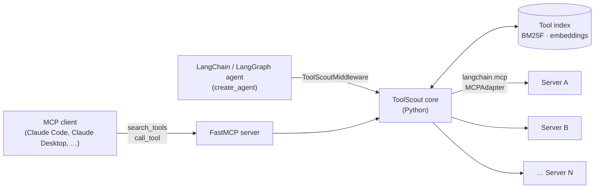

# ToolScout

**A search-then-call gateway for MCP: let agents use hundreds of tools without loading them all into context.**

> **Status: proposal.** This repository currently contains design docs and plans only. There is no code yet.
> See the [Roadmap](docs/ROADMAP.md) for what gets built and when.

---

## The problem

Every MCP server an agent connects to adds its tool definitions to the model's context on every request. That's fine for 10 tools. It breaks down at hundreds:

- **Token cost.** Loading 2,792 tool definitions would take about 206K tokens, which exceeds many models' context windows ([Stacklok](https://stacklok.com/blog/stackloks-mcp-optimizer-vs-anthropics-tool-search-tool-a-head-to-head-comparison/)).
- **Wrong tool choices.** With 70 servers and 527 tools, retrieval errors account for nearly half of agent failures ([LiveMCPBench](https://arxiv.org/abs/2508.01780)).
- **Look-alike tools.** Several servers often expose tools with nearly the same name and purpose (`search`, `create_issue`, `read_file`), and the model has to tell them apart.

## What ToolScout does

ToolScout sits between an agent and many MCP servers. It's built in Python on [LangChain](https://docs.langchain.com/oss/python/langchain/overview) and [LangGraph](https://docs.langchain.com/oss/python/langgraph/overview), and it can be used in two ways:

1. **As an MCP server** for any MCP client (Claude Code, Claude Desktop, …). To the client it looks like one server with two tools.
2. **As LangChain middleware** for agents built with `create_agent`. The agent sees only the tools that matter for the current step.

| Tool | What it does |
|---|---|
| `search_tools(query, k)` | Finds the `k` most relevant tools across all connected servers and returns their names, descriptions and input schemas |
| `call_tool(name, arguments)` | Checks the arguments against the tool's schema, forwards the call to the right server and returns the result |



A typical exchange over MCP:

```text
Agent → search_tools({"query": "weather forecast for a city", "k": 3})
      ← [ wanderly_get_weather, … ]   (names, descriptions, input schemas)
Agent → call_tool({"name": "wanderly_get_weather",
                   "arguments": {"latitude": 35.01, "longitude": 135.77}})
      ← (the upstream server's result, passed through unchanged)
```

## How it's different

Similar ideas already exist: Anthropic's [tool search tool](https://platform.claude.com/docs/en/agents-and-tools/tool-use/tool-search-tool), Stacklok's MCP Optimizer, MCPProxy, and, inside the LangChain ecosystem, [`langgraph-bigtool`](https://github.com/langchain-ai/langgraph-bigtool), `LLMToolSelectorMiddleware` and `ProviderToolSearchMiddleware`. ToolScout's focus:

- **Works with any client and any model.** It's a plain MCP server first. The LangChain middleware is a second surface over the same core, not a replacement.
- **Every design choice is measured.** A retrieval benchmark ships in the repo and gates every change in CI. The end-to-end results report **cost per successful task**, not just retrieval accuracy, and compare against the LangChain-native options above.
- **A strong lexical baseline first.** Field-weighted BM25 (BM25F) over tool names, descriptions and parameters needs no API keys and no embedding service. Hybrid search (BM25F + embeddings, fused with LangChain's `EnsembleRetriever`) is opt-in and has to earn its place in the benchmark.
- **Built on standard parts.** Upstream connections use `langchain.mcp`, retrievers implement LangChain's `BaseRetriever`, the server surface uses [FastMCP](https://gofastmcp.com), and the evaluation agent runs on LangGraph.

## How it will be measured

| Layer | Question | Main metrics |
|---|---|---|
| Retrieval benchmark (runs in CI) | Does search put the right tools in the top k? | Recall@k, complete-recall@k, MRR, p50/p95 latency |
| End-to-end agent runs (LangGraph) | Do agents finish more tasks, more cheaply? | Task success, tokens per task, cost per successful task |
| Failure attribution | Why did a failed run fail? | Share of failures by cause (never retrieved, look-alike chosen, bad arguments, …) |

Details: [docs/EVALUATION.md](docs/EVALUATION.md).

## Planned usage

> The interface below is a plan and will change as the build progresses.

```yaml
# toolscout.yaml
servers:
  - name: wanderly
    command: ["./wanderly-mcp"]
  - name: files
    command: ["npx", "-y", "@modelcontextprotocol/server-filesystem", "~/notes"]
  - name: remote-example
    url: https://example.com/mcp
    headers:
      Authorization: "Bearer ${EXAMPLE_TOKEN}"

retrieval:
  mode: lexical      # lexical | hybrid
  default_k: 5
  embeddings: null   # e.g. "ollama:nomic-embed-text" or "openai:text-embedding-3-small" for hybrid

pinned: []           # tools that are always visible to the agent
```

As an MCP server:

```bash
uvx toolscout serve --config toolscout.yaml      # run as an MCP server over stdio
uvx toolscout search "create a calendar event"   # debug: show ranked tools
uvx toolscout eval --suite retrieval             # run the retrieval benchmark
```

As LangChain middleware:

```python
from langchain.agents import create_agent
from toolscout import ToolScout
from toolscout.langchain import ToolScoutMiddleware

async with ToolScout.from_config("toolscout.yaml") as scout:
    agent = create_agent(
        "claude-haiku-5-5",
        tools=scout.tools,                         # every upstream tool, as LangChain tools
        middleware=[ToolScoutMiddleware(scout, k=5)],  # only the top k reach the model each step
    )
    await agent.ainvoke({"messages": [{"role": "user", "content": "What's the weather in Kyoto?"}]})
```

## Roadmap

| Milestone | Target | Outcome |
|---|---|---|
| M0 Proposal | Sep 28, 2026 ✅ | First docs (Go design) |
| M0.5 Re-plan | Oct 25, 2026 ✅ | These docs, moved to Python, LangChain and LangGraph |
| M1 Gateway skeleton | Nov 1 | Connect to servers via `langchain.mcp`, build the catalog, serve `search_tools` / `call_tool` with FastMCP |
| M2 Lexical search | Nov 8 | BM25F retriever, debug CLI, first benchmark numbers |
| M3 Hybrid, middleware, CI gate | Nov 15 | Embeddings, `EnsembleRetriever`, `ToolScoutMiddleware`, labeled benchmark, GitHub Actions gate |
| M4 End-to-end | Nov 22 | LangGraph agent runs on LiveMCPBench, cost and failure analysis |
| M5 v0.1 release | Nov 29 | Results in README, demo, setup guides, PyPI release |
| Phase 2 (optional) | Later | Research questions: who writes the query, doc2query, look-alike tools |

Full plan with checklists: [docs/ROADMAP.md](docs/ROADMAP.md).

## Docs

- [Proposal](docs/PROPOSAL.md): motivation, goals, prior work, success criteria, risks
- [Design](docs/DESIGN.md): architecture, components, search scoring, safety
- [Evaluation](docs/EVALUATION.md): benchmark, end-to-end experiments, statistics
- [Roadmap](docs/ROADMAP.md): milestones and checklists
- [Decisions](docs/DECISIONS.md): decisions made so far and open questions

## Related work

- Anthropic, [Introducing advanced tool use](https://www.anthropic.com/engineering/advanced-tool-use) and the [tool search tool](https://platform.claude.com/docs/en/agents-and-tools/tool-use/tool-search-tool)
- LangChain, [`langgraph-bigtool`](https://github.com/langchain-ai/langgraph-bigtool) and the [v1 agent middleware](https://reference.langchain.com/python/langchain/middleware/) (`LLMToolSelectorMiddleware`, `ProviderToolSearchMiddleware`)
- [LiveMCPBench: Can Agents Navigate an Ocean of MCP Tools?](https://arxiv.org/abs/2508.01780)
- [RAG-MCP: Mitigating Prompt Bloat in LLM Tool Selection via Retrieval-Augmented Generation](https://arxiv.org/abs/2505.03275)
- [MCP-Zero: Active Tool Discovery for Autonomous LLM Agents](https://arxiv.org/abs/2506.01056)
- [Retrieval Models Aren't Tool-Savvy (ToolRet)](https://aclanthology.org/2025.findings-acl.1258/)
- Stacklok, [MCP Optimizer vs. Anthropic's Tool Search Tool](https://stacklok.com/blog/stackloks-mcp-optimizer-vs-anthropics-tool-search-tool-a-head-to-head-comparison/)
- StackOne, [Comparing BM25, TF-IDF, and Hybrid Search for MCP Tool Discovery](https://www.stackone.com/blog/mcp-tool-search-bm25-tfidf-hybrid/)

## License

[MIT](LICENSE)
