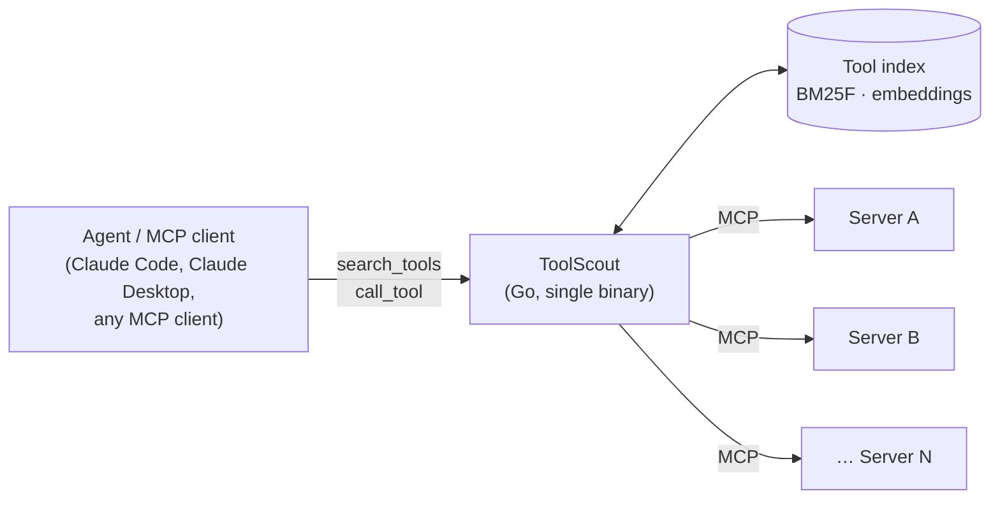

# ToolScout

**A search-then-call gateway for MCP: let agents use hundreds of tools without loading them all into context.**

> **Status: proposal.** This repository currently contains design docs and plans only. There is no code yet.
> See the [Roadmap](docs/ROADMAP.md) for what gets built and when.

---

## The problem

Every MCP server an agent connects to adds its tool definitions to the model's context on every request. That's fine for 10 tools. It breaks down at hundreds:

- **Token cost.** Loading 2,792 tool definitions would take about 206K tokens, which exceeds many models' context windows ([Stacklok](https://stacklok.com/blog/stackloks-mcp-optimizer-vs-anthropics-tool-search-tool-a-head-to-head-comparison/)).
- **Wrong tool choices.** With 70 servers and 527 tools, retrieval errors account for nearly half of agent failures ([LiveMCPBench](https://arxiv.org/abs/2508.01780)).
- **Look-alike tools.** Several servers often expose tools with nearly the same name and purpose (`search`, `create_issue`, `read_file`), and the model has to tell them apart.

## What ToolScout does

ToolScout sits between an agent and many MCP servers. To the agent it looks like **one MCP server with two tools**:

| Tool | What it does |
|---|---|
| `search_tools(query, k)` | Finds the `k` most relevant tools across all connected servers and returns their names, descriptions and input schemas |
| `call_tool(name, arguments)` | Checks the arguments against the tool's schema, forwards the call to the right server and returns the result |



A typical exchange:

```text
Agent → search_tools({"query": "weather forecast for a city", "k": 3})
      ← [ wanderly__get_weather, … ]   (names, descriptions, input schemas)
Agent → call_tool({"name": "wanderly__get_weather",
                   "arguments": {"latitude": 35.01, "longitude": 135.77}})
      ← (the upstream server's result, passed through unchanged)
```

## How it's different

Similar ideas already exist: Anthropic's [tool search tool](https://platform.claude.com/docs/en/agents-and-tools/tool-use/tool-search-tool), Stacklok's MCP Optimizer and MCPProxy. ToolScout's focus:

- **Works with any client and any model.** It's a plain MCP server, not a feature of one model API.
- **Every design choice is measured.** A retrieval benchmark ships in the repo and gates every change in CI. The end-to-end results report **cost per successful task**, not just retrieval accuracy.
- **A strong lexical baseline first.** Field-weighted BM25 (BM25F) over tool names, descriptions and parameters needs no API keys and no embedding service. Hybrid search (BM25 + embeddings) is opt-in and has to earn its place in the benchmark.
- **One Go binary** built on the official [MCP Go SDK](https://github.com/modelcontextprotocol/go-sdk).

## How it will be measured

| Layer | Question | Main metrics |
|---|---|---|
| Retrieval benchmark (runs in CI) | Does search put the right tools in the top k? | Recall@k, complete-recall@k, MRR, p50/p95 latency |
| End-to-end agent runs | Do agents finish more tasks, more cheaply? | Task success, tokens per task, cost per successful task |
| Failure attribution | Why did a failed run fail? | Share of failures by cause (never retrieved, look-alike chosen, bad arguments, …) |

Details: [docs/EVALUATION.md](docs/EVALUATION.md).

## Planned usage

> The interface below is a plan and will change as the build progresses.

```yaml
# toolscout.yaml
servers:
  - name: wanderly
    command: ["./wanderly-mcp"]
  - name: files
    command: ["npx", "-y", "@modelcontextprotocol/server-filesystem", "~/notes"]
  - name: remote-example
    url: https://example.com/mcp
    headers:
      Authorization: "Bearer ${EXAMPLE_TOKEN}"

retrieval:
  mode: lexical      # lexical | hybrid
  default_k: 5

pinned: []           # tools that are always visible to the agent
```

```bash
toolscout serve --config toolscout.yaml          # run as an MCP server over stdio
toolscout search "create a calendar event"       # debug: show ranked tools
toolscout eval --suite retrieval                 # run the retrieval benchmark
```

## Roadmap

| Milestone | Target | Outcome |
|---|---|---|
| M0 Proposal | Week of Sep 28, 2026 | These docs |
| M1 Gateway skeleton | Week 1 | Connect to servers, collect tools, serve `search_tools` / `call_tool` |
| M2 Lexical search | Week 2 | BM25F index, debug CLI, first benchmark numbers |
| M3 Hybrid + CI gate | Week 3 | Embeddings, rank fusion, labeled benchmark, GitHub Actions gate |
| M4 End-to-end | Week 4 | Agent runs on LiveMCPBench, cost and failure analysis |
| M5 v0.1 release | Week 5 | Results in README, demo, setup guides |
| Phase 2 (optional) | Later | Research questions: who writes the query, doc2query, look-alike tools |

Full plan with checklists: [docs/ROADMAP.md](docs/ROADMAP.md).

## Docs

- [Proposal](docs/PROPOSAL.md): motivation, goals, prior work, success criteria, risks
- [Design](docs/DESIGN.md): architecture, components, search scoring, safety
- [Evaluation](docs/EVALUATION.md): benchmark, end-to-end experiments, statistics
- [Roadmap](docs/ROADMAP.md): milestones and checklists
- [Decisions](docs/DECISIONS.md): decisions made so far and open questions

## Related work

- Anthropic, [Introducing advanced tool use](https://www.anthropic.com/engineering/advanced-tool-use) and the [tool search tool](https://platform.claude.com/docs/en/agents-and-tools/tool-use/tool-search-tool)
- [LiveMCPBench: Can Agents Navigate an Ocean of MCP Tools?](https://arxiv.org/abs/2508.01780)
- [RAG-MCP: Mitigating Prompt Bloat in LLM Tool Selection via Retrieval-Augmented Generation](https://arxiv.org/abs/2505.03275)
- [MCP-Zero: Active Tool Discovery for Autonomous LLM Agents](https://arxiv.org/abs/2506.01056)
- [Retrieval Models Aren't Tool-Savvy (ToolRet)](https://aclanthology.org/2025.findings-acl.1258/)
- Stacklok, [MCP Optimizer vs. Anthropic's Tool Search Tool](https://stacklok.com/blog/stackloks-mcp-optimizer-vs-anthropics-tool-search-tool-a-head-to-head-comparison/)
- StackOne, [Comparing BM25, TF-IDF, and Hybrid Search for MCP Tool Discovery](https://www.stackone.com/blog/mcp-tool-search-bm25-tfidf-hybrid/)

## License

[MIT](LICENSE)
