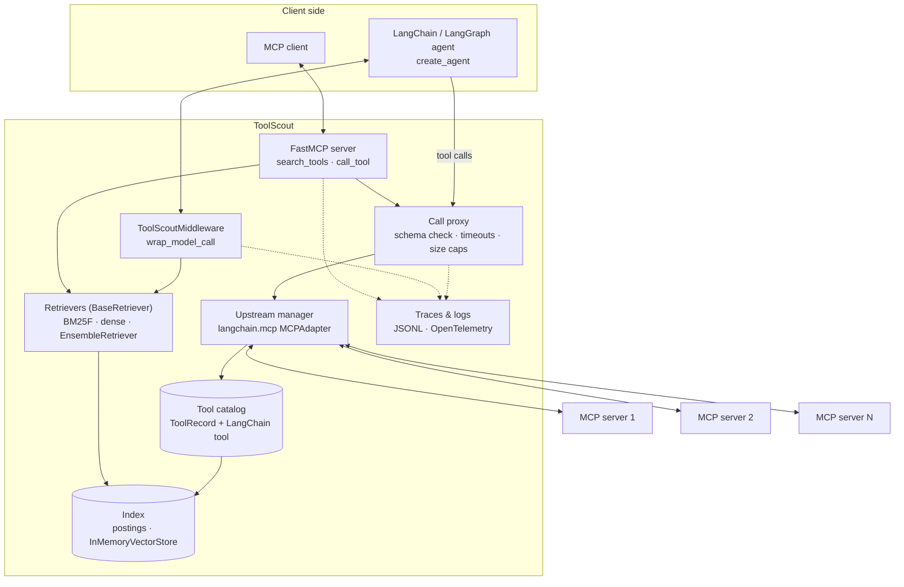

# ToolScout: Design

*Status: draft. This describes the planned design; details will change during M1–M3. Revised October 25, 2026 for Python, LangChain and LangGraph.*

## 1. Overview

ToolScout has one core and two surfaces:

- **Core.** Connects to upstream MCP servers through `langchain.mcp`, keeps a catalog of their tools, indexes it, and answers searches.
- **MCP surface.** A FastMCP server with a small, fixed set of tools, for any MCP client.
- **LangChain surface.** `ToolScoutMiddleware`, which filters the tools a `create_agent` agent sees on each model call.



Where LangChain is used and where it isn't:

| Part | Built with | Why |
|---|---|---|
| Upstream connections | `langchain.mcp.MCPAdapter` (on FastMCP) | Multi-server config, stdio and Streamable HTTP, tool namespacing, and tools that are already LangChain tools |
| Agent-facing MCP server | FastMCP | LangChain consumes MCP but doesn't serve it |
| Retriever interface | `langchain_core.retrievers.BaseRetriever` | One interface for BM25F, dense and hybrid, and it plugs into `EnsembleRetriever` and rerankers |
| BM25F scoring | Own code | Stock `BM25Retriever` (rank_bm25) has no field weights |
| Embeddings and cache | LangChain `Embeddings`, `CacheBackedEmbeddings` | Swap local and API models without new code |
| Dense index | `InMemoryVectorStore` | Brute-force cosine; no vector database needed at this scale |
| Hybrid fusion | `EnsembleRetriever` | Weighted reciprocal rank fusion, built in |
| Agent integration | LangChain v1 middleware | `wrap_model_call` can change `request.tools` per call |
| Evaluation agent | `create_agent` (runs on LangGraph) | One agent loop for every condition, with middleware for limits and tracing |

## 2. The MCP surface

### `search_tools`

| Parameter | Type | Notes |
|---|---|---|
| `query` | string, required | A natural-language description of what the agent wants to do |
| `k` | int, optional | Default from config (5), max 20 |
| `server` | string, optional | Limit the search to one server |

It returns up to `k` results. Each has the namespaced tool name, the server, the title and description (trimmed to a token budget), the input schema, and the tool's annotations. It also returns a short note when the scores are very close ("these tools are similar; compare descriptions").

### `call_tool`

| Parameter | Type | Notes |
|---|---|---|
| `name` | string, required | A namespaced name returned by `search_tools` |
| `arguments` | object | Checked against the tool's input schema before it's forwarded |

It returns the upstream result unchanged: content blocks, structured content and `isError`. When the checks fail inside ToolScout (unknown tool, schema mismatch, timeout), the result has `isError: true` and a message the agent can act on, such as "missing required field `latitude`".

### Pinned tools

Tools listed under `pinned` in the config are exposed directly, next to `search_tools` and `call_tool`. This is for the few tools an agent uses in almost every task.

### Dynamic exposure (experimental, Phase 2)

After a search, ToolScout can add the found tools to its own tool list and send `notifications/tools/list_changed`, so the client sees them as ordinary tools. This depends on how each client handles the notification, so it's off by default on the MCP surface. On the LangChain surface it doesn't depend on the client at all (see 3).

### Tool names

`MCPAdapter` namespaces upstream tools as `<server>_<tool>`, so two servers can both expose `search`. ToolScout keeps that format by default so names match what LangChain users already see. A single underscore is ambiguous when server names contain underscores, so server names in the config are restricted to `[a-z0-9-]`, and the catalog keeps `server` and the original tool name as separate fields. See Q1 in [DECISIONS.md](DECISIONS.md).

## 3. The LangChain surface

`ToolScoutMiddleware` is an `AgentMiddleware` that hooks `wrap_model_call`. The agent is created with every upstream tool (`scout.tools`), so LangGraph's tool node can run any of them. Before each model call, the middleware replaces `request.tools` with a short list and calls the handler with `request.override(tools=...)`.

It has three modes:

| Mode | What the model sees on each call | Who writes the query |
|---|---|---|
| `retrieve` (default) | Pinned tools + top `k` for a query built from the latest user message and recent tool results | ToolScout |
| `search` | Pinned tools + `search_tools`; tools found by earlier searches in this thread are added to the list | The model |
| `gateway` | Pinned tools + `search_tools` + `call_tool`, exactly like the MCP surface | The model |

`search` mode is dynamic exposure without any client support. The found tool IDs are kept in the agent state (a custom state field on the middleware), so they survive across steps and, with a checkpointer, across turns. That makes Phase 2's "who writes the query" question a config change rather than a new client.

```python
class ToolScoutMiddleware(AgentMiddleware):
    def __init__(self, scout: ToolScout, k: int = 5, mode: str = "retrieve"): ...

    async def awrap_model_call(self, request, handler):
        visible = await self._select(request)          # ranked tool IDs → LangChain tools
        self._trace(request, visible)                  # same trace format as search_tools
        return await handler(request.override(tools=visible))
```

## 4. Components

### 4.1 Config

A YAML file lists the upstream servers, which are either stdio commands or Streamable HTTP URLs with headers. It also sets the pinned tools, retrieval settings and limits. `${VAR}` references are filled from the environment, so secrets never live in the file. The config is loaded into a Pydantic model and converted to an `MCPConfig` dict (`{"mcpServers": {...}}`) for `MCPAdapter`. Servers that need different transport settings can be given as FastMCP `Client`s in a `ClientGroup` instead.

### 4.2 Upstream manager

- Opens one `MCPAdapter` over all configured servers and calls `list_tools()`. Each result is a LangChain tool that holds its own client, so it stays callable after discovery.
- Refreshes the catalog with `list_tools(cache_mode="refresh")` on a timer and on demand (`toolscout index`). Servers that advertise cache hints are re-listed when their TTL runs out. Whether `MCPAdapter` passes `notifications/tools/list_changed` through is checked in M1. If it doesn't, ToolScout listens with FastMCP's client.
- Tracks health per server (connected, degraded, down) from listing and call results, and retries listing with exponential backoff.
- If one server fails, the others keep working. Search still returns that server's tools, marked unavailable, so the agent learns why a call failed.
- `MCPAdapter` opens a session per tool call. Per-call overhead for stdio and legacy-protocol servers is measured in M1, against the proxy overhead budget in section 6.

### 4.3 Tool catalog

Each tool is stored as a normalized record next to its LangChain tool:

```python
@dataclass(frozen=True)
class ToolRecord:
    id: str              # "<server>_<tool>", as MCPAdapter names it
    server: str          # server name from config
    name: str            # original upstream tool name
    title: str | None
    description: str
    params: list[Param]  # name, type, description, required; flattened from inputSchema
    input_schema: dict   # the full JSON Schema, for validation
    annotations: dict    # readOnlyHint, destructiveHint, idempotentHint, openWorldHint (hints only)
    schema_hash: str     # hash of the full definition, for cache keys and change detection

catalog: dict[str, tuple[ToolRecord, BaseTool]]
```

When a server's tool list changes, only the records whose `schema_hash` changed are reindexed. Each record is also turned into a LangChain `Document` (text from the fields below, `metadata={"tool_id": ..., "server": ...}`) for the dense retriever.

### 4.4 Indexing and tokenization

Each tool becomes a document with **fields**:

| Field | Source | Starting weight (tuned on the dev split) |
|---|---|---|
| `name` | tool name, split into words | 3.0 |
| `title` | tool title, if present | 2.0 |
| `description` | tool description | 1.0 |
| `params` | parameter names and descriptions | 0.6 |
| `server` | server name | 0.5 |
| `examples` | doc2query example requests (Phase 2, off by default) | 1.0 |

The `server` weight starts low on purpose. Otherwise a query that mentions "github" ranks every GitHub tool above the one that actually does the job.

Tokenizer:
1. Split identifiers on `_`, `-`, `.`, `/` and camelCase: `createGitHubIssue` → `create git hub issue`, and `github_create_issue` → `github create issue`. Keep the joined form too, so that `github` still matches.
2. Lowercase, remove stop words, apply light stemming (Porter, as in my earlier search engine).
3. Use the same pipeline for queries and documents.

### 4.5 Retrievers

All retrievers implement LangChain's `BaseRetriever` and return `Document`s whose metadata carries `tool_id`, `score` and `rank`. ToolScout adds a small protocol on top for indexing:

```python
class ToolRetriever(BaseRetriever):
    k: int = 5

    def index(self, tools: list[ToolRecord]) -> None: ...
    def _get_relevant_documents(self, query: str, *, run_manager) -> list[Document]: ...
```

**BM25F (default).** Field-weighted term frequency, normalized by field length, then BM25 saturation:

```text
tf~(t, d) = Σ_f  w_f · tf_f(t, d) / (1 − b_f + b_f · len_f(d) / avglen_f)
score(q, d) = Σ_{t ∈ q}  idf(t) · tf~(t, d) · (k1 + 1) / (tf~(t, d) + k1)
```

Starting values: `k1 = 1.2`, `b_f = 0.75`, tuned on the dev split only. This is the scoring from my earlier engine, where field boosts were applied to term frequency before saturation, reused as Python code. The disk-backed parts of that engine (SPIMI, external merging, compressed postings) aren't needed here. A few thousand tools fit in memory, so the index is a dict from term to postings.

**Stock BM25 (ablation only).** `langchain_community.retrievers.BM25Retriever` over the concatenated fields, with the same tokenizer passed as `preprocess_func`. It shows how much field weighting adds.

**Dense.** Any LangChain `Embeddings` model, wrapped in `CacheBackedEmbeddings` with a `LocalFileStore`, so each tool document is embedded once and reused until its text changes. Queries are embedded at search time. Search uses `InMemoryVectorStore` (brute-force cosine): 10,000 tools × 1,024 dimensions is about 10M multiply-adds per query, which takes milliseconds, so no vector database is needed. Two embedding setups are planned:
- a local model through `langchain-ollama`
- an API model (for example `langchain-openai`)

**Hybrid.** `EnsembleRetriever` over BM25F and dense, each returning its top 50, fused with weighted reciprocal rank fusion:

```text
rrf(d) = Σ_r  w_r / (60 + rank_r(d))
```

The weights start equal and are tuned on the dev split.

**Reranker (Phase 2).** `ContextualCompressionRetriever` with a cross-encoder or LLM reranker over the top 20.

### 4.6 Call proxy

Both surfaces send calls through the same proxy. On the MCP surface it backs `call_tool`. On the LangChain surface it wraps each upstream tool before it's handed to `create_agent`.

- **Schema check.** Arguments are validated with `jsonschema` against the raw `inputSchema` before forwarding, so the agent gets a precise error without an upstream round trip.
- **Timeouts.** `asyncio.timeout` per call (default 30 s, can be set per server) and cancellation when the client cancels.
- **Size cap.** Results larger than a configured size are truncated, with a clear marker, so one tool can't flood the context.
- **Retries.** Only for tools annotated `idempotentHint: true`, and only on transport errors. (On the LangChain surface, `ToolRetryMiddleware` is not used for upstream tools, because it doesn't know which tools are safe to retry.)

### 4.7 Safety policy

Tool annotations are **hints from servers that may not be trusted**. They inform the policy but never replace it.

- Allow and deny lists per server and per tool.
- `destructive: hide | allow` (default `hide`). Tools annotated `destructiveHint: true` are left out of search results unless the config allows them. On the LangChain surface, users who allow them can add `HumanInTheLoopMiddleware` for those tools.
- Tool descriptions are shown to the model as data. ToolScout never follows instructions found in them.
- ToolScout never logs argument values by default, since they can contain secrets or personal data.

### 4.8 Observability

- Structured JSON logs.
- OpenTelemetry spans for `search_tools` and middleware selections (query, k, retriever, ranked IDs and scores, latency) and for calls (tool, server, latency, error class).
- A JSONL trace file. This is the source of truth for evaluation and failure attribution. For example, "the agent called a tool that search never returned" is detected from traces. On the LangChain surface the same records are written by the middleware and a callback handler.
- LangSmith tracing works with no extra code when `LANGSMITH_TRACING` is set. It's a convenience for debugging, not something the evaluation depends on.

### 4.9 CLI

Built with Typer.

| Command | Purpose |
|---|---|
| `toolscout serve` | Run as an MCP server (stdio by default, `--http :8080` for Streamable HTTP) |
| `toolscout index` | Connect to all servers and export the catalog as JSONL |
| `toolscout search "<query>"` | Show ranked tools with per-field score breakdowns, for debugging |
| `toolscout eval --suite retrieval` | Run the retrieval benchmark and write a results file |
| `toolscout eval --suite e2e` | Run end-to-end agent runs (needs model API keys) |

## 5. Planned repository layout

```text
pyproject.toml           uv project; extras: [hybrid], [eval]
src/toolscout/
  cli.py                 Typer entry point
  config.py              Pydantic config, env expansion, MCPConfig conversion
  upstream.py            MCPAdapter wrapper, refresh, health
  catalog.py             ToolRecord, hashing, change detection, Documents
  text.py                tokenizer, stemming, identifier splitting
  retrieve/              bm25f.py, dense.py, hybrid.py (EnsembleRetriever), base.py
  server.py              FastMCP surface: search_tools, call_tool, pinned tools
  langchain.py           ToolScoutMiddleware
  proxy.py               schema checks, timeouts, size caps, retries
  obs.py                 logging, OpenTelemetry, JSONL traces, callback handler
evals/
  retrieval/             labels, decoys, runner
  e2e/                   LangGraph agent runner, conditions, judge, attribution
  results/               committed results with config and data versions
tests/
docs/                    these documents
```

## 6. Performance budget (targets)

Targets are for pure Python on a laptop, at ~2,500 tools.

| Operation | Target |
|---|---|
| Full lexical index build | < 2 s |
| Incremental reindex of one server | < 200 ms |
| `search_tools` p95, lexical | < 15 ms |
| `search_tools` p95, hybrid with local embeddings | < 100 ms |
| Middleware overhead per model call, lexical | < 20 ms |
| Proxy overhead on `call_tool` (excluding upstream and session setup) | < 10 ms |
