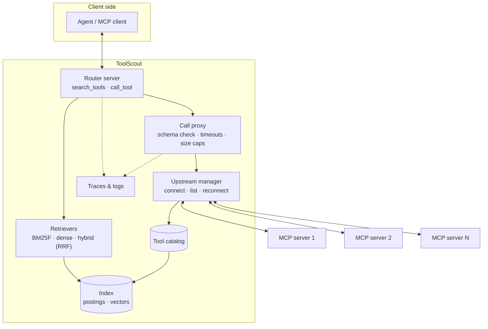

# ToolScout: Design

*Status: draft. This describes the planned design; details will change during M1–M3.*

## 1. Overview

ToolScout plays two MCP roles at once:

- **To the agent**, it's one MCP server with a small, fixed set of tools.
- **To upstream servers**, it's an MCP client that connects to each one, lists its tools and forwards calls.



## 2. The surface the agent sees

### `search_tools`

| Parameter | Type | Notes |
|---|---|---|
| `query` | string, required | A natural-language description of what the agent wants to do |
| `k` | int, optional | Default from config (5), max 20 |
| `server` | string, optional | Limit the search to one server |

It returns up to `k` results. Each has the namespaced tool name, the server, the title and description (trimmed to a token budget), the input schema, and the tool's annotations. It also returns a short note when the scores are very close ("these tools are similar; compare descriptions").

### `call_tool`

| Parameter | Type | Notes |
|---|---|---|
| `name` | string, required | A namespaced name returned by `search_tools` |
| `arguments` | object | Checked against the tool's input schema before it's forwarded |

It returns the upstream result unchanged: content blocks, structured content and `isError`. When the checks fail inside ToolScout (unknown tool, schema mismatch, timeout), the result has `isError: true` and a message the agent can act on, such as "missing required field `latitude`".

### Pinned tools

Tools listed under `pinned` in the config are exposed directly, next to `search_tools` and `call_tool`. This is for the few tools an agent uses in almost every task.

### Dynamic exposure (experimental, Phase 2)

After a search, ToolScout can add the found tools to its own tool list and send `notifications/tools/list_changed`, so the client sees them as ordinary tools. This depends on how each client handles the notification, so it's off by default.

### Tool names

Upstream tools are namespaced as `<server>__<tool>` so that two servers can both expose `search`. The exact separator will be checked against the MCP spec's tool-name rules in M1 (see [DECISIONS.md](DECISIONS.md)).

## 3. Components

### 3.1 Config

A YAML file lists the upstream servers, which are either stdio commands or Streamable HTTP URLs with headers. It also sets the pinned tools, retrieval settings and limits. `${VAR}` references are filled from the environment, so secrets never live in the file.

### 3.2 Upstream manager

- Connects to each server with the official Go SDK client, over stdio or Streamable HTTP.
- Calls `tools/list`, following pagination, when a server connects and whenever it sends `notifications/tools/list_changed`.
- Reconnects with exponential backoff and tracks health per server (connected, degraded, down).
- If one server fails, the others keep working. Search still returns that server's tools, marked unavailable, so the agent learns why a call failed.

### 3.3 Tool catalog

Each tool is stored as a normalized record:

```text
ToolRecord {
  id            "<server>__<tool>"
  server        server name from config
  name, title   from the tool definition
  description   from the tool definition
  params        [{name, type, description, required}] flattened from inputSchema
  annotations   readOnlyHint, destructiveHint, idempotentHint, openWorldHint (hints only)
  schemaHash    hash of the full definition, used for cache keys and change detection
}
```

When a server's tool list changes, only the records whose `schemaHash` changed are reindexed.

### 3.4 Indexing and tokenization

Each tool becomes a document with **fields**:

| Field | Source | Starting weight (tuned on the dev split) |
|---|---|---|
| `name` | tool name, split into words | 3.0 |
| `title` | tool title, if present | 2.0 |
| `description` | tool description | 1.0 |
| `params` | parameter names and descriptions | 0.6 |
| `server` | server name | 0.5 |
| `examples` | doc2query example requests (Phase 2, off by default) | 1.0 |

The `server` weight starts low on purpose. Otherwise a query that mentions "github" ranks every GitHub tool above the one that actually does the job.

Tokenizer:
1. Split identifiers on `_`, `-`, `.`, `/` and camelCase: `createGitHubIssue` → `create git hub issue`, and `github_create_issue` → `github create issue`. Keep the joined form too, so that `github` still matches.
2. Lowercase, remove stop words, apply light stemming (Porter, as in my earlier search engine).
3. Use the same pipeline for queries and documents.

### 3.5 Retrievers

All retrievers share one interface:

```go
type Retriever interface {
    Search(ctx context.Context, q Query) ([]Hit, error) // Hit = {ToolID, Score, Rank}
    Index(ctx context.Context, tools []ToolRecord) error
    Name() string
}
```

**BM25F (default).** Field-weighted term frequency, normalized by field length, then BM25 saturation:

```text
tf~(t, d) = Σ_f  w_f · tf_f(t, d) / (1 − b_f + b_f · len_f(d) / avglen_f)
score(q, d) = Σ_{t ∈ q}  idf(t) · tf~(t, d) · (k1 + 1) / (tf~(t, d) + k1)
```

Starting values: `k1 = 1.2`, `b_f = 0.75`, tuned on the dev split only. This matches the design of my earlier engine, where field boosts were applied to term frequency before saturation. The disk-backed parts of that engine (SPIMI, external merging, compressed postings) aren't needed here. A few thousand tools fit in memory, so the index is a map from term to postings.

**Dense.** Embeds each tool document once and caches the vector by `schemaHash` on disk. Queries are embedded at search time. Search is brute-force cosine similarity in memory: 10,000 tools × 1,024 dimensions is about 10M multiply-adds per query, which takes milliseconds, so no vector database is needed. The embedding provider is an interface, with two planned implementations:
- a local model, served for example through Ollama
- an API model

**Hybrid.** Reciprocal rank fusion of the top 50 results from BM25F and from dense:

```text
rrf(d) = Σ_r  1 / (60 + rank_r(d))
```

**Reranker (Phase 2).** An optional cross-encoder or LLM rerank of the top 20.

### 3.6 Call proxy

- **Schema check.** Arguments are validated against `inputSchema` before forwarding, so the agent gets a precise error without an upstream round trip.
- **Timeouts.** A timeout per call (default 30 s, can be set per server) and cancellation when the client cancels.
- **Size cap.** Results larger than a configured size are truncated, with a clear marker, so one tool can't flood the context.
- **Retries.** Only for tools annotated `idempotentHint: true`, and only on transport errors.

### 3.7 Safety policy

Tool annotations are **hints from servers that may not be trusted**. They inform the policy but never replace it.

- Allow and deny lists per server and per tool.
- `destructive: hide | allow` (default `hide`). Tools annotated `destructiveHint: true` are left out of search results unless the config allows them.
- Tool descriptions are shown to the model as data. ToolScout never follows instructions found in them.
- ToolScout never logs argument values by default, since they can contain secrets or personal data.

### 3.8 Observability

- Structured JSON logs.
- OpenTelemetry spans for `search_tools` (query, k, retriever, ranked IDs and scores, latency) and for `call_tool` (tool, server, latency, error class).
- An optional JSONL trace file. The evaluation uses these traces for failure attribution. For example, "the agent called a tool that search never returned" is detected from traces.

### 3.9 CLI

| Command | Purpose |
|---|---|
| `toolscout serve` | Run as an MCP server (stdio by default, `--http :8080` for Streamable HTTP) |
| `toolscout index` | Connect to all servers and export the catalog as JSONL |
| `toolscout search "<query>"` | Show ranked tools with per-field score breakdowns, for debugging |
| `toolscout eval --suite retrieval` | Run the retrieval benchmark and write a results file |

## 4. Planned repository layout

```text
cmd/toolscout/         CLI entry point
internal/config/       YAML config and env expansion
internal/upstream/     connections, listing, reconnects, health
internal/catalog/      ToolRecord, hashing, change detection
internal/text/         tokenizer, stemming, identifier splitting
internal/retrieve/     bm25f/, dense/, hybrid/, Retriever interface
internal/router/       MCP server surface: search_tools, call_tool, pinned tools
internal/proxy/        schema checks, timeouts, size caps
internal/obs/          logging, tracing, JSONL traces
evals/                 benchmark data, labels, decoys, runners, results
docs/                  these documents
```

## 5. Performance budget (targets)

| Operation | Target at ~2,500 tools |
|---|---|
| Full lexical index build | < 1 s |
| Incremental reindex of one server | < 100 ms |
| `search_tools` p95, lexical | < 10 ms |
| `search_tools` p95, hybrid with local embeddings | < 100 ms |
| Proxy overhead on `call_tool` (excluding upstream) | < 5 ms |
